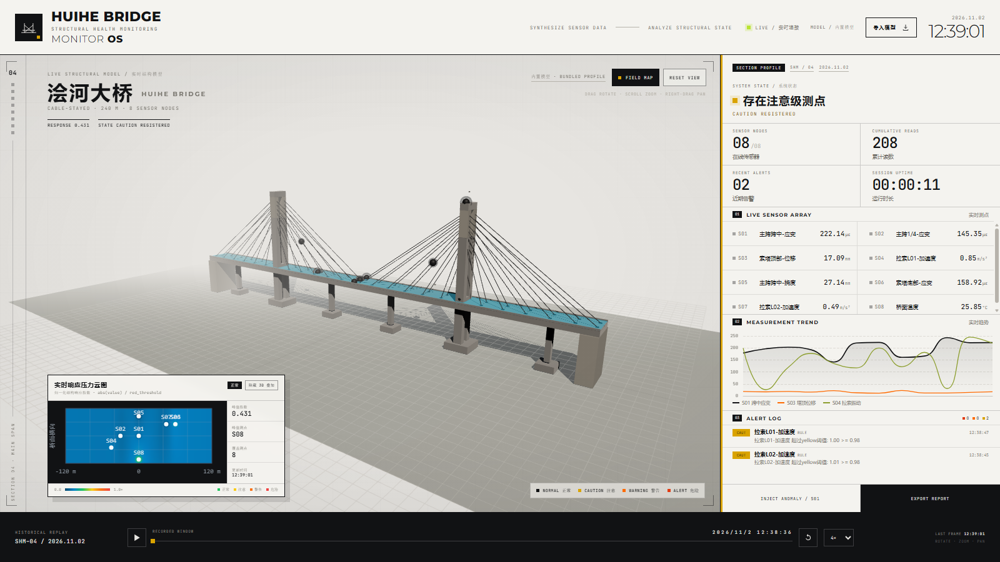
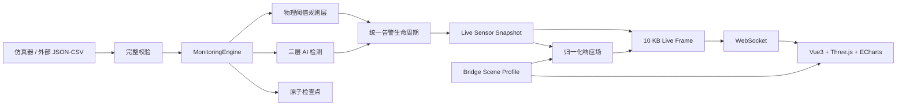

# 桥梁数字孪生结构健康监测平台

**Bridge Digital Twin Structural Health Monitoring Platform**

平台面向大跨径桥梁运维，覆盖传感器接入、结构状态判断、三维表达、历史回放和监测报告。



## 项目简介

桥梁监测项目经常停在数据展示：曲线很多，结构状态和处置依据却不够清楚。

本平台以一座主跨 120 m 的斜拉桥为演示对象，围绕以下目标构建：

- 把应变、位移、加速度和温度读数映射到统一的 3D 桥梁模型。
- 规则和 AI 同时判断异常；AI 的结果要经过投票、认知度/不确定性门控和特征/空间仲裁。
- 让 3D 场景、测点、图表和响应场读取同一份 Scene Profile。
- 给实时帧设固定字节预算；内容超限时按固定顺序降级，慢客户端单独断开。
- 用检查点恢复运行状态，用测试、验收和公开数据基准留下可重跑的证据。

## 核心能力

| 能力 | 说明 |
| --- | --- |
| 实时监测 | 1 Hz 仿真/外部数据流，WebSocket 推送 |
| 三维数字孪生 | Three.js + glTF/BIM 模型，测点与构件状态联动 |
| 响应场 | 25×9 桥面归一化响应云图，支持实时与历史 |
| 三层检测 | 物理规则 + STALWART-inspired/GAN-AE/Isolation Forest 投票 + 特征/空间仲裁 |
| 分级预警 | 黄/橙/红三级，统一告警生命周期与 10 秒事件时间冷却 |
| 历史回放 | 任意时刻快照、时间轴、1x–16x 倍速 |
| 模型导入 | 自包含 GLB/glTF 2.0，100 MB 上限，不可变 Scene Profile revision |
| 结构分析 | 仿真-实测补偿、模态全场变形反演 |
| 报告 | 可打印 HTML 监测报告 |
| 多形态部署 | Web、Docker 后端、Windows 单机桌面应用 |

## 一条完整逻辑链路



### 处理顺序

1. **接入校验**：JSON/CSV 批次最多 10,000 条；任一记录非法，整批拒绝，不产生部分写入。
2. **数据摄入**：最新值 O(1) 查找、500 条滚动窗口、每测点最多 100,000 条历史、Top-K 峰值。
3. **状态投影**：服务器按阈值和逐测点 override 生成 `physical_state`，并独立生成 `connection_state`。
4. **规则告警**：按红/橙/黄从高到低匹配绝对值阈值，统一进入告警生命周期。
5. **AI 检测**：三模型独立基线、独立投票；至少 2 票且置信度 ≥0.7 才确认异常。
6. **不确定性门控**：认知度 <0.35 或不确定性 ≥0.45 时限制等级，并路由到第三层仲裁。
7. **特征/空间仲裁**：均值漂移、方差变化、趋势斜率至少 2 项超限才确认；空间残差区分“孤立坏点”和“结构协同响应”。
8. **实时表达**：每帧最多 32 个测点，10 KB UTF-8 预算内确定性降级，慢客户端单独断开。
9. **持久化**：临时文件 + `fsync` + 原子替换，损坏检查点不影响服务启动。

> 规则和 AI 并行运行。第三层只处理模型分歧、低认知或高不确定性的样本。

## 技术架构

| 层 | 技术选型 | 职责 |
| --- | --- | --- |
| 前端 | Vue 3、TypeScript、Vite | 单屏监控台、实时/回放状态编排 |
| 3D | Three.js、glTF 2.0 | 桥梁模型、测点、构件高亮、压力场贴图 |
| 图表 | ECharts | 实时趋势、历史曲线 |
| 后端 | FastAPI、Pydantic、Uvicorn | REST、WebSocket、应用装配 |
| 数据 | NumPy、Python 标准库 | 内存引擎、检测、补偿、模态反演 |
| 机器学习 | NumPy、scikit-learn | 轻量 GAN-AE、Isolation Forest |
| 测试 | pytest、httpx、websockets | 384 个后端测试、接口/性能/实时验收 |
| 部署 | Docker、PyInstaller、pywebview | 容器后端、Windows 桌面应用 |

### 目录速览

```text
backend/app/
├── api/               REST 路由
├── engine/            数据引擎与仿真器
├── ml/                检测、仲裁、补偿、模态反演
├── ws/                WebSocket 管理
├── live_contract.py   Live Frame 合同与预算
├── live_stream.py     进程级 1 Hz 实时循环
├── processing.py      摄入→规则→AI→持久化
├── persistence.py     原子检查点
└── main.py            FastAPI 应用装配

frontend/src/
├── App.vue            监控台、Three.js、ECharts
├── composables/       实时连接与回放
├── components/        压力云图、模型导入
└── scene/             Scene Profile 消费

benchmarks/
├── acceptance.py      系统验收入口
├── stability.py       长稳测试入口
└── vba/               公开振动数据基准
```

## 三层检测怎么工作

```text
                        ┌────────────────────┐
传感器读数 ────────────▶│ 第一层：物理阈值规则 │──▶ 确定性告警
                        └────────────────────┘
                        ┌────────────────────┐
                 ──────▶│ 第二层：三模型投票   │──▶ 一致异常
                        │ STALWART-inspired  │
                        │ GAN-AE             │
                        │ Isolation Forest   │
                        └─────────┬──────────┘
                                  │ 分歧 / 低认知 / 高不确定性
                                  ▼
                        ┌────────────────────┐
                        │ 第三层：特征/空间仲裁 │──▶ 确认 / 疑似 / 正常
                        │ 均值漂移            │
                        │ 方差变化            │
                        │ 趋势斜率            │
                        │ 跨传感器残差         │
                        └────────────────────┘
```

每个模型按测点独立学习基线。默认需要 100 条正常读数进入 ready；未就绪时只学习，不产生 AI 告警。检测结果保留投票、置信度、认知度、不确定性、特征超限项、空间证据和阈值快照，便于解释与复盘。

## 技术特点

- **完整运行链路**：接入、校验、存储、规则、AI、告警、3D、回放、报告和恢复都在同一套服务里。
- **规则与 AI 互补**：规则保证安全底线，AI 发现未知模式，仲裁负责处理分歧。
- **告警保留判断依据**：模型投票、特征证据、空间一致性和阈值来源随告警一起保存。
- **数字孪生一致性**：Scene Profile 是模型、测点、图表和响应场的唯一空间事实源。
- **有界实时传输**：10 KB 帧预算、固定降级顺序、慢客户端隔离。
- **工程化可靠性**：检测器故障隔离、损坏检查点容忍、模型索引容错、显式降级。
- **验收结果可以重跑**：依赖版本、数据哈希、测试、性能门槛、算法基准和报告产物都留在仓库。

## 技术优势

1. **噪声和单点故障不容易直接变成告警**：基线学习、多模型、多窗口特征和空间残差共同参与判断。
2. **高危结论需要多个模型确认**：低认知或高不确定性时只输出低等级，并转入仲裁。
3. **状态和证据放在同一屏**：3D 空间状态、响应云图、趋势和告警记录可以直接对照。
4. **扩展时不必改整条链路**：检测器、模型存储、检查点和告警来源都有固定接口。
5. **现场可以离线运行**：Windows 单机版内置后端、前端和本地状态。

## 技术创新点

> 以下属于工程组合创新与落地创新，不主张单个基础算法为行业首创。

- **不确定性驱动的分层决策**：模型分歧、认知度和不确定性决定样本是否进入下一层。
- **空间一致性仲裁**：用其他测点重建目标测点，区分孤立坏点与真实结构协同响应，并对孤立超限限制等级。
- **Scene Profile 单一事实源**：模型变换、桥面边界、测点锚点、图表角色和响应场共用不可变 profile revision。
- **带可靠性与回退的两阶段补偿**：仿真给基础响应，实测修正偏差；超域/高方差/低可靠时回退物理阈值。
- **带可靠度的模态全场反演**：能量选模、方向置信度加权、正则化求解，并输出条件数、残差和可靠度。
- **预算内可审计降级**：实时帧明确记录省略项和文本精度，避免把传输裁剪误认为“没有异常”。

## 当前验收数据

以下结果来自当前仓库的本机单进程验收，不代表任意生产环境。

| 项目 | 结果 |
| --- | ---: |
| 后端测试 | **384 passed** |
| 10,000 条批量摄入 | **393.76 ms** |
| 常规查询 p95 | **7.47 ms** |
| 历史快照 p95 | **1.04 ms** |
| 三层检测 p95 | **11.45 ms** |
| API 吞吐 | **152.65 QPS** |
| WebSocket | **10/10 客户端**，帧延迟 p95 **9.10 ms** |
| 合成验证集准确率 | **0.9924** |
| 合成验证集误报率 | **0.0023** |

合成验证集包含 24 小时、8 测点、69,120 条读数、1,440 个一分钟窗口；确认后召回率 0.9407，事件召回率 1.0000。

VBA 公开振动数据的录音级融合基准结果为准确率 0.9706、误报率 0.0278、F1 0.9688。该结果是离线录音级分类，不是线上逐读数精度，也不是结构应力/位移预测精度。详见 [技术文档](docs/TECHNICAL_DOCUMENT.md) 和 `benchmarks/vba/enhanced-v1.md`。

## 快速开始

### 环境要求

- Python 3.11+（本次验收使用 Python 3.13.7）
- Node.js 20+ 与 pnpm

### 1. 安装后端

```powershell
py -3.13 -m venv .venv
.\.venv\Scripts\python.exe -m pip install -r backend\requirements.txt
```

### 2. 启动后端

```powershell
cd backend
..\.venv\Scripts\python.exe -m uvicorn app.main:app --reload --port 8000
```

### 3. 启动前端

```powershell
cd frontend
pnpm install
pnpm dev
```

打开 `http://localhost:5173`。Vite 会把 `/api` 和 `/ws` 代理到 `http://localhost:8000`。

### Docker

```bash
docker compose up --build
```

后端暴露 `http://localhost:8000` 和 `ws://localhost:8000/ws/live`，状态保存到 `bridge-state` 卷。

### Windows 桌面应用

```powershell
powershell -NoProfile -ExecutionPolicy Bypass -File .\scripts\run_desktop.ps1
```

构建可分发版本：

```powershell
powershell -NoProfile -ExecutionPolicy Bypass -File .\scripts\build_windows.ps1
```

也可直接双击根目录 `start_windows_app.bat` 启动已构建版本。

## 主要接口

| 路径 | 用途 |
| --- | --- |
| `GET /api/health` | 服务、检测器、持久化和实时循环状态 |
| `GET /api/sensors/` | 全部测点最新状态 |
| `GET /api/sensors/history/snapshot?ts=` | 指定时刻快照 |
| `POST /api/data/upload/json` | 批量 JSON，最多 10,000 条 |
| `POST /api/data/upload/csv` | UTF-8 CSV 批量上传 |
| `POST /api/data/upload/single` | 单条实时读数 |
| `GET /api/alerts/` | 最近告警 |
| `GET /api/analysis/detectors` | 模型健康、基线进度、统计 |
| `POST /api/analysis/inject-anomaly` | 指定测点生成并处理一条注入读数 |
| `GET /api/analysis/response-field` | 实时/历史归一化响应场 |
| `POST /api/analysis/response-estimate` | 仿真-实测补偿估计 |
| `POST /api/analysis/deformation-inversion` | 模态全场变形反演 |
| `GET /api/analysis/report?hours=24` | HTML 监测报告 |
| `GET /api/models/active` | 当前模型与 Scene Profile |
| `POST /api/models/import` | 导入 GLB/glTF 2.0 |
| `WS /ws/live` | 1 Hz 实时帧 |

运行后可在 `http://localhost:8000/docs` 查看完整 OpenAPI。

## 数据与边界

- 当前主验证数据为**合成数据**，用于验证行为、接口合同和可复现性，不代表真实桥梁工程精度。
- 阈值档案为 `competition-design-basis-v1`（`provisional`），不是正式审批限值。
- VBA 基准为录音级加速度损伤分类，不能外推为多传感器逐读数精度。
- 响应场是归一化响应指数，不是物理压力，也不是有限元应力结果。
- 当前为单进程内存状态架构，未实现认证、RBAC、多租户和真实工业协议接入。
- 24 小时长稳入口已实现，但现有提交产物是短时烟雾测试；正式提交前应完成一次完整 24 小时验收。

这些边界在技术文档中有逐项说明，答辩时建议主动讲清楚，避免过度承诺。

## 测试与验收

```powershell
# 全量后端测试
.\.venv\Scripts\python.exe -m pytest -q

# 系统验收（测试 + 摄入 + 查询 + AI + API 负载 + WebSocket + 验证集）
.\.venv\Scripts\python.exe -m benchmarks.acceptance

# VBA 录音级融合基准
.\.venv\Scripts\python.exe -m benchmarks.vba.evaluate --mode enhanced

# 长稳测试入口
.\.venv\Scripts\python.exe -m benchmarks.stability --hours 24 --probe-interval 60 --clients 10

# 前端类型检查与生产构建
cd frontend
pnpm build
```

验收产物分别写入 `benchmarks/runs/`、`benchmarks/vba/` 和 `benchmarks/stability/runs/`。

## 文档导航

- [完整技术文档](docs/TECHNICAL_DOCUMENT.md)：架构、逻辑链路、算法公式、接口合同、技术优势、创新点、验收与边界。
- [领域词汇](CONTEXT.md)：统一传感器、在线状态、告警、实时帧和融合增强术语。
- [架构决策记录](docs/adr/)：15 项 ADR，记录关键设计取舍。
- [阈值依据](docs/thresholds/sensor-baseline-and-mapping.md)：S01–S08 设计基准与审批接口。
- [VBA 基准说明](benchmarks/vba/README.md)：数据、转换、折分和验收门槛。

## 提交材料

- [技术文档 DOCX](assets/planning/桥梁数字孪生健康监测平台_技术文档_v1.1.docx)：A4 正式排版，含封面、自动目录、图表、验收数据和工程边界。
- [技术文档 PDF](assets/planning/桥梁数字孪生健康监测平台_技术文档_v1.1.pdf)：DOCX 的只读预览版，共 23 页。
- [答辩 PPTX](assets/planning/桥梁数字孪生健康监测平台_答辩PPT_10页_v1.1.pptx)：10 页技术答辩演示，含逐页讲稿备注。
- [答辩 PPT PDF](assets/planning/桥梁数字孪生健康监测平台_答辩PPT_10页_v1.1.pdf)：PPTX 的只读预览版。

## 适用场景

本项目适合作为桥梁结构健康监测、数字孪生、工程数据可视化、异常检测和边缘部署方向的教学、竞赛与原型验证平台。面向真实工程部署时，需要在现场数据标定、长期稳定性、工业协议接入、时序数据库、权限审计和工程审批流程上继续补强。
