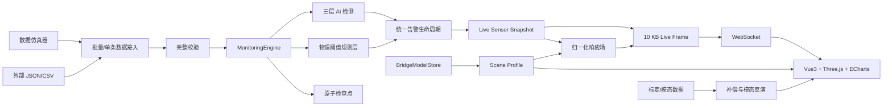
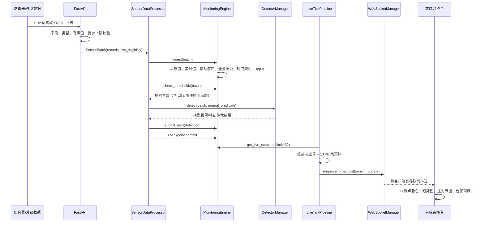

# 桥梁数字孪生结构健康监测平台技术文档

> 面向桥梁运维的结构健康监测（SHM）平台：接收多源传感器数据，完成规则与 AI 判断，并把结构状态、告警证据、历史回放和报告放在同一条运行链路里。

## 0. 文档信息

| 项目 | 内容 |
| --- | --- |
| 文档版本 | 1.0 |
| 更新时间 | 2026-11-03 |
| 对应代码 | `backend/`、`frontend/`、`benchmarks/` |
| 文档状态 | 与当前仓库实现一致 |
| 适用场景 | 工程场景数字化竞赛、技术答辩、后续工程化评审 |

### 0.1 阅读约定

本文把以下三类信息分开描述，避免把演示能力、合成数据结果和真实工程精度混为一谈：

- **已实现能力**：当前仓库中存在代码、接口或自动化测试的功能。
- **验收数据**：在指定命令、指定数据集和当前机器环境下可以复现的结果。
- **工程边界**：当前版本尚未完成、不能对外宣称的能力。

文中的性能数字默认来自本机单进程、回环网络和固定版本依赖，不等于任意生产环境性能。

---

## 1. 项目定义

### 1.1 工程问题

传统桥梁运维通常依赖定期人工巡检、离线检测和单点阈值报警。常见问题有四类：

1. **响应滞后**：病害从出现到被发现可能跨越数天甚至更长。
2. **数据割裂**：应变、位移、加速度、温度数据分散，缺少统一的数据语义和空间解释。
3. **误报与漏报并存**：单点固定阈值无法区分传感器噪声、单点漂移和真实结构响应。
4. **结果难解释**：只有“报警/不报警”，缺少模型投票、特征证据、空间一致性和阈值来源。

本项目以一座主跨 120 m 的斜拉桥演示场景为对象，构建从传感器数据到结构状态、分级预警和处置证据的工程软件原型。

### 1.2 目标用户

- 桥梁运维人员：查看实时结构状态、历史趋势、告警证据和巡检报告。
- 结构工程师：检查测点阈值、响应场、模态反演和模型空间配置。
- 算法/平台研发人员：替换检测器、接入真实数据、扩展标定与验收流程。
- 演示与评审人员：通过可操作界面理解系统从数据到决策的完整链路。

### 1.3 设计目标

| 目标 | 实现方式 |
| --- | --- |
| 实时感知 | 1 Hz 仿真或外部数据流，WebSocket 推送实时帧 |
| 分级预警 | 黄/橙/红三级物理阈值 + AI 异常告警 |
| 降低误报 | 多模型投票、认知度/不确定性门控、跨传感器空间残差、事件时间冷却 |
| 可解释 | 保留模型投票、置信度、特征超限项、空间证据、阈值快照 |
| 三维映射 | BIM/glTF 模型与统一 Scene Profile 驱动测点、构件和响应场 |
| 历史追溯 | 时间范围查询、任意时刻快照、1x–16x 回放、HTML 报告 |
| 验收可重跑 | 自动化测试、性能验收、合成验证集、VBA 公开数据基准 |
| 可部署 | Web 前后端、Docker 后端、Windows 单机桌面应用 |

### 1.4 当前版本的非目标

- 不把竞赛设计阈值宣称为正式工程限值。
- 不把合成数据精度宣称为真实桥梁的工程精度。
- 不声称单个算法为行业首创；创新点来自系统组合、工程约束和可验证落地。
- 当前版本不包含正式身份认证、租户隔离、审批流和云端多租户计费。
- 当前版本不替代有限元分析、桥梁设计验算和持证工程师判断。

### 1.5 成功标准

| 维度 | 当前可验证标准 |
| --- | --- |
| 数据完整性 | 非法批次在写入前整体拒绝，不产生部分状态 |
| 告警一致性 | 规则与 AI 告警共用统一生命周期、冷却和保留策略 |
| 实时性 | 1 Hz 帧；10 个 WebSocket 客户端可同时接收 |
| 性能 | 10,000 条批量摄入 ≤ 500 ms；三层检测 p95 ≤ 200 ms |
| 可解释性 | 告警保存来源、阈值、模型投票、仲裁特征和空间证据 |
| 可恢复性 | 原子检查点；损坏检查点不阻止服务启动 |
| 可验收性 | pytest、系统验收、VBA 基准均有固定命令和产物 |

---

## 2. 系统上下文

### 2.1 外部参与者

- **传感器/仿真器**：提供带时间戳的应变、位移、加速度、温度读数。
- **运维人员**：查看大屏、回放历史、导出报告、手动注入演示异常。
- **桥梁模型文件**：GLB/glTF 2.0 模型与可选的 Bridge Scene Profile。
- **标定与模态数据**：仿真-实测补偿和全场变形反演所需的版本化 JSON 数据。

### 2.2 运行形态

1. **前后端分离开发**：FastAPI 监听 8000，Vite 监听 5173，Vite 代理 `/api` 与 `/ws`。
2. **单进程生产式服务**：FastAPI 同时托管构建后的前端静态资源和 API。
3. **桌面单机应用**：pywebview 启动本地 FastAPI，使用空闲回环端口打开 `/app`。
4. **容器后端**：Docker 暴露 REST 与 WebSocket，检查点挂载到持久卷。

### 2.3 总体架构



### 2.4 分层职责

| 层 | 主要模块 | 职责 |
| --- | --- | --- |
| 接入层 | `api/routes_data.py`、`ingestion.py` | REST、CSV/JSON 校验、批量上限、实时资格 |
| 业务层 | `processing.py`、`engine/data_engine.py` | 数据存储、阈值判定、告警生命周期、历史查询 |
| 算法层 | `ml/` | 基线学习、三模型投票、特征仲裁、空间残差、补偿、模态反演 |
| 实时层 | `live_stream.py`、`live_contract.py`、`ws/` | 单进程实时循环、帧预算、慢客户端治理 |
| 孪生层 | `bridge_models.py`、`bridge_scene_profile.py` | 模型导入、激活、不可变 Profile revision |
| 表达层 | `frontend/src/` | 3D 场景、压力云图、趋势图、回放、报告、告警面板 |
| 可靠性层 | `persistence.py`、`observability.py` | 原子检查点、请求 ID、稳定错误、健康检查 |

---

## 3. 模块与目录

```text
bridge-digital-twin-platform/
├── backend/app/
│   ├── api/                  REST 路由
│   ├── engine/               数据引擎与仿真器
│   ├── ml/                   检测、仲裁、补偿、模态反演
│   ├── ws/                   WebSocket 连接与消息上限
│   ├── live_contract.py      Live Frame 合同与降级策略
│   ├── live_stream.py        进程级实时循环
│   ├── processing.py         摄入→规则→AI→持久化编排
│   ├── persistence.py        原子检查点
│   └── main.py               FastAPI 应用装配
├── frontend/src/
│   ├── App.vue               单屏监控台、Three.js、ECharts
│   ├── composables/          实时/回放状态编排
│   ├── components/           压力云图、模型导入
│   └── scene/                Scene Profile 消费逻辑
├── benchmarks/
│   ├── acceptance.py         系统验收入口
│   ├── stability.py          长稳测试入口
│   └── vba/                  VBA 录音级基准
├── data/                     样本、验证、标定、模态数据
├── docs/adr/                 架构决策记录
└── desktop/                  Windows 桌面壳
```

### 3.1 关键服务组装

`create_services()` 每次创建一套隔离的可变服务状态，包含：

- `MonitoringEngine`：内存数据引擎。
- `DataSimulator`：8 测点数据生成与异常注入。
- `DetectorManager`：检测器插件注册、失败隔离、基线与统计。
- `SensorDataProcessor`：唯一在线处理编排入口。
- `WebSocketManager`：有界队列与慢客户端处理。
- `BridgeModelStore`：模型导入和激活。
- `ResponseCompensationEstimator`、`ModalInversionModel`：分析能力。
- `CheckpointManager`：状态恢复与提交。
- `LiveStreamRunner`：进程级 1 Hz 实时循环。

测试通过 `create_app()` 创建独立应用，避免测试之间共享传感器、告警和仿真状态。

## 4. 端到端逻辑链路

### 4.1 实时链路总览



### 4.2 实时链路分步说明

#### 第 1 步：数据进入

实时数据有两个来源：

- 内置仿真器：每次生成 S01–S08 共 8 条读数，默认 1 Hz。
- 外部接入：`POST /api/data/upload/single`、`/upload/json`、`/upload/csv`。

JSON/CSV 批次最多 10,000 条。每条必须具备 `sensor_id`、`name`、`type`、`value`、`timestamp`；类型仅允许 `strain`、`displacement`、`acceleration`、`temperature`。批次在任何状态写入前完整校验，单条错误会使整批返回 400。

`push_live` 决定数据是否具备 Live Eligibility：

- `true`：参与后续 1 Hz Live Frame 和实时告警。
- `false`：进入历史和告警分析，但不进入实时帧。

#### 第 2 步：数据引擎摄入

`MonitoringEngine.ingest()` 对每个读数维护：

- 每传感器最新读数：字典 O(1) 查找。
- 每传感器 Live 最新读数：只接收 Live Eligible 数据。
- 500 条滚动窗口：供统计和趋势使用。
- 每传感器最多 100,000 条完整历史：供回放和报告使用。
- 独立时间戳数组：支持二分查找和时段计数。
- Top-K 峰值堆：快速展示全局最大异常点。
- 未来时间读数隔离区：未来时间戳不会污染当前状态。

批内乱序数据会按时间排序后再裁剪；全量历史溢出时淘汰最旧记录。

#### 第 3 步：物理状态投影

服务器在读取时生成 `physical_state` 与 `connection_state`，前端不再自行计算阈值：

- `physical_state`：`normal`、`yellow`、`orange`、`red`、`unknown`。
- `connection_state`：`online`、`offline`。

物理状态使用读数绝对值、当前 Threshold Profile 和可选的逐测点 override。时间超前超过新鲜度窗口、阈值缺失、阈值不完整或 override 类型不匹配时，状态为 `unknown`，不会默认成正常。

#### 第 4 步：物理阈值规则告警

规则层按红、橙、黄从高到低匹配：

```text
level = 满足 |value| >= threshold 的最高等级
```

告警保存：

- UUID、传感器 ID/名称、等级、原始带符号值、触发阈值。
- 事件时间、来源 `rule`、检测序号、可选的解释详情。
- 创建时的传感器名称和阈值快照，后续改阈值不会篡改历史告警。

所有规则和 AI 告警统一经过 `submit_alert()`，按“传感器 + 等级”应用 10 秒事件时间冷却，并全局保留最新 50,000 条告警。

#### 第 5 步：三层 AI 检测

AI 与规则层并行执行，形成安全网：

1. **第一层：物理规则**：确定性、低延迟、可解释，承担最低安全底线。
2. **第二层：三模型集成**：STALWART-inspired EMA、GAN-AE、Isolation Forest 分别投票。
3. **第三层：特征/空间仲裁**：仅在模型分歧或不确定性门控触发时介入。

每个检测器按传感器独立学习基线。默认需要 100 条正常读数进入 ready；未就绪时只学习、不出 AI 告警。基线与模型状态可通过 `/api/analysis/detectors` 查看，并支持单测点或全量重学。

#### 第 6 步：告警生命周期

告警来源统一为：

- `rule`
- `ai_stalwart`
- `ai_gan_ae`
- `ai_isolation_forest`
- `ai_dual_confirm`
- `ai_feature_arbitration`

生命周期边界负责 ID、冷却、排序、保留和快照。相同传感器相同等级在 10 秒事件时间窗口内只保留一次；同一时刻的告警用单调检测序号稳定排序。

#### 第 7 步：实时帧组装与推送

`LiveTickPipeline` 每个周期执行：

1. 生成/读取仿真读数。
2. 跳过来自外部接口、尚待消费的同一传感器读数，避免仿真覆盖外部实时值。
3. 调用统一处理器完成摄入、规则、AI 和持久化。
4. 读取最新 Live Eligible 快照，最多 32 个测点。
5. 根据当前 Scene Profile 生成 25×9 归一化响应场。
6. 通过 `LiveFrameAssembler` 在 10 KB UTF-8 上限内组装帧。
7. 广播给每个 WebSocket 客户端。

帧预算降级顺序固定为：

```text
完整帧
→ 压力场去掉逐点元数据
→ 去掉压力场
→ 压缩文本
→ 最小文本
→ 从最旧传感器开始移除
→ 仍无法满足则跳过该帧并记录错误
```

帧内始终携带 `budget.limit_bytes` 与 `budget.omissions`，消费者能区分“字段本来没有”和“因预算被省略”。

#### 第 8 步：前端表达

- Three.js 渲染 BIM/glTF 桥梁模型、测点球体、构件高亮和压力云图贴图。
- ECharts 展示主应变、塔顶位移、拉索加速度趋势。
- 右侧面板展示系统状态、在线测点数、累计读数、告警计数、告警日志。
- 历史回放通过 REST 时间快照驱动，不依赖 WebSocket 重放。
- 模型导入后重新加载模型与 profile，保证渲染、测点和压力场使用同一空间解释。

### 4.3 历史回填链路

历史数据走同一处理管线，但标记为 `BACKFILL`：

```text
CSV/JSON 上传(push_live=false)
→ 完整校验
→ MonitoringEngine.ingest
→ 物理阈值和 AI 检测
→ 告警标记 live_eligible=false
→ 历史查询/报告可见，实时帧不显示
```

这使离线补录可以参与诊断和报告，又不会把旧数据误当成“当前状态”。

### 4.4 桥梁模型导入链路

```text
multipart 上传
→ 扩展名与 100 MB 上限
→ 分块写入临时文件
→ GLB 头或 glTF 2.0 JSON 校验
→ 自包含资源校验
→ 原子提升到模型目录
→ 生成/接收 Scene Profile
→ 更新 index.json
→ 可选激活
→ 前端重载模型与 profile
```

导入约束：

- 只接受 `.glb` 或 `.gltf`。
- glTF 必须是 2.0。
- 外部 `.bin`、纹理等 sidecar 资源被拒绝，必须导出为 GLB 或内嵌 data URI。
- 导入模型使用不透明 ID 存储，激活选择持久化在 `index.json`。
- 删除模型不会破坏当前激活选择的一致性；不存在/损坏索引会被安全忽略。

### 4.5 Scene Profile 链路

Bridge Scene Profile 是模型空间解释的唯一权威来源，包含：

- 右手米制坐标帧：X 纵向、Y 向上、Z 横向。
- 模型平移、旋转、缩放、源单位缩放。
- 桥面范围 `deck_bounds`。
- 测点锚点 `sensor_anchors`。
- 图表角色 `measurement_roles`。
- 显示元数据。

同一 profile 同时驱动：

- 3D 场景渲染与相机适配。
- 测点位置和构件健康着色。
- 图表主应变/塔顶位移/拉索加速度角色选择。
- 响应压力场网格边界和传感器投影位置。

profile 采用不可变 revision。缺失 profile 时，系统可从 glTF 节点变换、accessor 边界和 deck/girder 命名推断 provisional profile；推断失败会显式报错，不回退到固定 240 m 几何。

### 4.6 分析能力链路

**仿真-实测补偿**：

```text
载荷/温度/损伤/跨径比特征
→ 仿真基础模型预测
→ 实测补偿模型修正
→ 方差、域距离、可靠性
→ 超域/高方差/低可靠时回退物理阈值
```

**模态全场变形反演**：

```text
稀疏测点 + 可选 SNR/置信度
→ 按能量选模
→ 方向置信度加权
→ 正则化最小二乘求模态坐标
→ 全场位移、重建应变、残差、可靠度
```

**响应压力场**：

```text
每个测点 abs(value) / red_threshold
→ 上限截断到 1.25
→ 按 Scene Profile 投影到桥面
→ 反距离权重插值到 25×9 网格
→ 输出归一化响应指数
```

该字段是“归一化响应指数”，不是物理压力，也不是有限元应力结果。

### 4.7 持久化链路

每个批次处理结束、阈值修改和进程正常停止都会提交检查点：

```text
导出完整领域状态
→ JSON 序列化（拒绝 NaN/Inf）
→ 临时文件写入
→ fsync
→ os.replace 原子替换
→ 目录 fsync（平台支持时）
```

启动时若检查点缺失、损坏或 schema 不兼容，只记录告警并继续启动，不阻塞演示和服务可用性。

---

## 5. 算法与模型设计

### 5.1 阈值与状态

类型级阈值满足严格递增：`yellow < orange < red`。逐测点 override 只对其声明类型生效。物理状态以绝对值判定，因此负向超限同样触发。

响应场归一化：

```text
ratio = min(abs(value) / red_threshold, 1.25)
```

### 5.2 STALWART-inspired EMA

对每个传感器维护快慢两个指数移动平均：

```text
fast_t = α_fast · x_t + (1 - α_fast) · fast_(t-1)
slow_t = α_slow · x_t + (1 - α_slow) · slow_(t-1)
z_t = |fast_t - slow_t| / σ_baseline
```

默认 `α_fast=0.3`、`α_slow=0.05`、阈值 `3σ`。它擅长捕捉突发跳变，计算量小，但不单独决定最终告警。

### 5.3 GAN-AE 重构检测

每个传感器从正常窗口学习轻量对抗自编码器：

```text
latent = Encoder(normalized_window)
reconstruction = Generator(latent)
error = mean((normalized_window - reconstruction)^2)
```

默认使用 8 个对抗子模型。重构误差超过训练分布阈值时投票；子模型投票分歧和误差离散度形成认知度/不确定性。实现是 NumPy 轻量模型，不依赖外部深度学习运行时。

### 5.4 Isolation Forest

每个传感器维护 200 条滚动窗口，使用 scikit-learn Isolation Forest（100 棵树）检测离群值。模型在获得足够正常样本后拟合，并按 25 条新正常读数异步重拟合。打分同时参考森林 decision function 和值分布偏离，降低单一评分尺度带来的阈值漂移。

### 5.5 三模型投票

每个模型先独立产生 `anomalous`、`confidence`、`score`、`cognition`、`uncertainty`。投票条件为：

```text
vote_i = ready_i AND anomalous_i AND confidence_i >= 0.7
confirmed = Σ vote_i >= 2
```

一致性置信度：

```text
consensus_confidence = mean(confidence of voting models) × min(cognition)
```

不确定性门控：

```text
gate = min(cognition) < 0.35 OR max(uncertainty) >= 0.45
```

无门控且至少 2 票时输出 `ai_dual_confirm`；3 票参与时等级为红，否则为橙。门控触发时等级封顶为黄，并转入第三层仲裁。

### 5.6 特征仲裁

第三层使用最近 20 条和此前 60 条，共 80 条窗口，计算三个标准化特征：

1. **均值漂移**：近期均值相对历史均值的变化。
2. **方差变化**：近期标准差相对历史标准差的比值变化。
3. **趋势斜率**：近期线性斜率按窗口跨度标准化。

判定规则：

- 3 个特征中至少 2 个超限：确认异常；2 个为橙，3 个为红。
- 仅 1 个超限：疑似异常，黄色。
- 0 个超限：正常。

该层只在第二层“有模型触发但票数不足”或“不确定性门控”时应用，避免对所有正常读数重复计算。

### 5.7 跨传感器空间残差

对每个目标传感器，用同一时刻其他传感器重建其值：

```text
ŷ_j = Φ_j β_j
minimize ||W^(1/2)(y - Φβ)||² + λ||β||²
```

实现为逐传感器岭回归。根据残差和边际 z-score 给出：

- `coherent`：多个传感器同时偏离，可能是真实结构事件。
- `isolated_outlier`：单点偏离且缺少空间支持，可将已确认异常降为黄色。
- `consistent`：当前测点与历史分布一致。
- `unavailable`：模型未就绪或通道不足。

空间证据只调节等级，不替代结构工程师判断。

### 5.8 仿真-实测两阶段补偿

第一阶段仿真模型给出基础响应；第二阶段实测模型修正系统偏差：

```text
ŷ_final = ŷ_simulation + g(features, ŷ_simulation)
```

可靠性同时考虑预测方差和训练域距离。超出训练域、方差过大或可靠性低于阈值时，返回 `prediction=null` 并回退物理阈值，同时给出回退原因，避免模型在未知工况下“自信地犯错”。

### 5.9 模态全场变形反演

结构响应近似为模态叠加：

```text
y ≈ Φq
q = (ΦᵀWΦ + λI)^(-1) ΦᵀWy
```

`Φ` 为应变/位移模态振型，`W` 为测量权重，`λ` 为正则项。系统先按能量贡献选模，再求解模态坐标，输出全场位移、重建应变、残差、条件数、R²、RRMSE 和可靠度。可靠度由能量覆盖、测量支撑度和条件数共同决定。

## 6. 状态语义与接口合同

### 6.1 关键状态语义

| 概念 | 含义 | 不应当混用为 |
| --- | --- | --- |
| Sensor Reading | 一个测点在一个时间戳的读数 | 任意采样点 |
| Known Sensor | 当前进程内至少收到过一条读数的测点 | 在线测点 |
| Online Sensor | 最新读数处于 60 秒新鲜度窗口内的测点 | 任一历史测点 |
| Physical State | 按物理阈值得到的 normal/yellow/orange/red/unknown | 连接状态 |
| Connection State | online/offline | 结构健康等级 |
| Live Eligible | 可进入后续 Live Frame 的读数 | 已入库读数 |
| Backfill | 只进入历史与分析，不进入实时帧 | 实时读数 |
| Cumulative Reading Count | 当前进程启动以来摄入的读数总数 | 在线测点数 |
| Period Reading Count | 指定时间区间内的读数数 | 累计读数 |
| Alert | 保留的告警记录，不是未关闭事件 | 工单/通知 |
| Alert Event Time | 触发告警的读数时间 | 告警入库时间 |

这些语义在 `CONTEXT.md` 中作为统一领域词汇维护，测试也针对这些边界编写。

### 6.2 Threshold Profile 与来源治理

当前默认阈值为 `competition-design-basis-v1`，状态 `provisional`。它不是正式审批限值，但每个值都有规范来源和推导记录：

- 应变：JT/T 1037-2022 表 9；SJG 148-2024 表 8.3.6。
- 索塔顶位移：按塔高 H/1000 量级拟定的演示整定值。
- 主跨挠度：JTG/T 3365-01-2020 §7.2.5，L/400。
- 拉索加速度：SJG 148-2024 表 8.3.6，100 mg / 300 mg。
- 温度：JTG D60-2015 表 4.3.12-2 与 JT/T 1037-2022 表 9。

系统支持两种来源状态：

- `provisional`：竞赛演示与算法验收基线，不能用于正式工程决策。
- `authoritative`：必须提供文档、版本、章节、生效日期和批准人。

面向正式部署时，只需在同一 JSON 中补齐审批元数据并设置 `status=authoritative`，无需改业务代码。该设计把“数值正确”和“来源可审计”分开治理。

当前已知边界：S08 只表达高温上限；负温度会因绝对值判定落入高温档，尚不能宣称覆盖低温报警。梯度温度也需要独立双向/差值模型。

### 6.3 REST API 概览

| 分组 | 路径 | 作用 |
| --- | --- | --- |
| 健康 | `GET /api/health` | 服务、检测器、持久化、实时循环状态 |
| 传感器 | `GET /api/sensors/` | 所有测点最新投影状态 |
| 传感器 | `GET /api/sensors/{id}` | 单测点最新状态 |
| 历史 | `GET /api/sensors/history/timerange` | 全量数据时间范围 |
| 历史 | `GET /api/sensors/history/range` | 指定测点/区间/降采样点数 |
| 历史 | `GET /api/sensors/history/snapshot?ts=` | 指定时刻快照 |
| 历史 | `GET /api/sensors/history/alerts` | 指定区间告警 |
| 告警 | `GET /api/alerts/`、`/recent`、`/stats` | 告警列表与统计 |
| 上传 | `POST /api/data/upload/json` | 最多 10,000 条 JSON 批次 |
| 上传 | `POST /api/data/upload/csv` | UTF-8 CSV 批次 |
| 上传 | `POST /api/data/upload/single` | 单条实时读数 |
| 阈值 | `GET /api/data/config/threshold-profile` | 阈值、来源、单位 |
| 阈值 | `POST /api/data/config/thresholds` | 当前实例类型级整定 |
| 检测 | `GET /api/analysis/detectors` | 模型健康、基线进度、统计 |
| 检测 | `POST /api/analysis/detectors/relearn` | 单测点或全量重学 |
| 演示 | `POST /api/analysis/inject-anomaly` | 指定测点生成一条注入读数 |
| 分析 | `POST /api/analysis/response-estimate` | 仿真-实测补偿估计 |
| 分析 | `POST /api/analysis/deformation-inversion` | 模态全场变形反演 |
| 分析 | `GET /api/analysis/response-field` | 实时/历史归一化响应场 |
| 报告 | `GET /api/analysis/report?hours=24` | 可打印 HTML 报告 |
| 模型 | `GET /api/models`、`/active`、`/active/profile` | 模型与 Scene Profile |
| 模型 | `POST /api/models/import` | 导入 GLB/glTF |
| 模型 | `POST /api/models/{id}/activate`、`/deactivate` | 激活/回退内置模型 |
| 模型 | `GET/POST /api/models/{id}/profile` | 读取/替换不可变 profile revision |
| 实时 | `WS /ws/live` | 订阅 1 Hz Live Frame |

FastAPI 自动提供 `/docs` 与 `/openapi.json`，接口细节以运行中的 OpenAPI 为准。

### 6.4 Live Frame 合同

顶层字段：

```json
{
  "type": "sensor_update",
  "sensors": [],
  "alerts": [],
  "stats": {},
  "threshold_profile": {"version": "...", "status": "provisional"},
  "pressure": {"type": "pressure_update", "...": "..."},
  "budget": {"limit_bytes": 10240, "omissions": []}
}
```

实时读数携带 `physical_state` 与 `connection_state`。实时告警采用有界投影：非法数值以 `null` 和 `invalid=true` 表达，完整证据仍可通过告警查询接口读取。

### 6.5 WebSocket 客户端治理

- 每个客户端一个异步发送任务。
- 每客户端队列上限 4 帧。
- 帧最大等待时间 0.5 秒。
- 队列满、发送超时或帧过期时断开慢客户端，不拖慢全局广播。
- 发送线程与实时生成线程通过线程安全的唤醒事件协作。

---

## 7. 工程可靠性与性能设计

### 7.1 数据结构选择

| 需求 | 结构 | 原因 |
| --- | --- | --- |
| 最新值 O(1) | `dict[sensor_id]` | 高频读写 |
| 滚动窗口 | `deque(maxlen=500)` | O(1) 追加/淘汰 |
| 全量回放 | 每传感器 `list` | 有序二分查询 |
| 时段计数 | `array('d')` | 紧凑时间戳存储 |
| Top-K | 最小堆 | O(log K) 维护 |
| 时间范围查询 | `bisect` + 降采样 | 避免全表扫描 |
| 告警冷却 | 每键有序时间数组 + `bisect` | 事件时间乱序也成立 |

### 7.2 并发模型

- FastAPI 异步处理 HTTP/WebSocket。
- 实时数据生成、规则、AI 和持久化在同一进程级后台线程中执行。
- 所有可变业务状态通过 `processing_lock` 串行化。
- 隔离森林重拟合在单独线程池执行，主检测路径不等待训练。
- 应用只建议单进程运行；多 worker 会分裂内存状态，因此不是当前版本的横向扩展方案。

### 7.3 故障隔离

| 故障 | 系统行为 |
| --- | --- |
| 单个 AI 模型异常 | 记录失败，其他模型和规则告警继续 |
| 检测管线整体异常 | 保留规则告警，批次仍完成持久化 |
| 检查点损坏 | 启动继续，健康接口标记降级 |
| 模型索引损坏 | 忽略无效条目，不阻止服务 |
| Scene Profile 推断失败 | 显式错误，不静默使用错误几何 |
| WebSocket 慢客户端 | 断开该客户端，不影响其他订阅者 |
| 实时帧超预算 | 按固定顺序降级；仍失败则跳过该帧 |

核心原则是“局部失败不升级为全局停机”，同时通过健康状态和错误日志暴露降级。

### 7.4 可观测性

- 每个 HTTP 请求生成或透传 `X-Request-ID`。
- 日志只记录方法、路径、状态、耗时和请求 ID。
- 未处理异常返回稳定 `INTERNAL_ERROR` 结构，不向客户端泄露堆栈。
- `/api/health` 汇总检测器、持久化、WebSocket、实时循环和阈值来源。
- 分析接口返回模型版本、回退原因、可靠性、条件数、残差等诊断字段。

### 7.5 输入与部署安全

- CORS 使用显式来源白名单，禁止与 credentials 搭配的 `*`。
- 批次先完整校验再写入，单条非法整批拒绝。
- 模型上传限制 100 MB，并校验 GLB/glTF 结构和自包含资源。
- 检查点拒绝 NaN/Inf，损坏数据不会进入领域状态。
- 当前未实现身份认证和权限模型，若用于公网或生产内网，必须在前置网关补齐认证、授权、审计与速率限制。

### 7.6 持久化与恢复

检查点采用临时文件 + `fsync` + 原子替换。它保证读者只能看到完整文件，避免进程在写入中途退出后留下半个 JSON。当前适配器是本地 JSON，接口 `CheckpointStore` 可替换为数据库或对象存储实现。

---

## 8. 前端、孪生与部署

### 8.1 前端交互

- 单屏监控台同时展示结构空间状态和运行指标。
- 3D 测点颜色与服务器 `physical_state` 对齐：正常、注意、警告、危险、未知。
- 压力云图既可作为桥面贴图，也可在独立面板查看网格和测点投影。
- 趋势图按 Scene Profile 的 Measurement Roles 选择传感器，不硬编码测点。
- 历史回放支持时间轴拖动、播放/暂停、1x/4x/8x/16x 倍速。
- 报告以 HTML 形式打开并可直接打印。

### 8.2 Web 与桌面

- Web 开发：Vite 5173 代理后端 8000。
- 单进程部署：FastAPI 托管 `frontend/dist`，`/app` 为应用入口。
- Windows 桌面：PyInstaller + pywebview，自动选择空闲回环端口，数据写入 `%LOCALAPPDATA%/BridgeDigitalTwin`。
- Docker：后端镜像以非 root 用户运行，健康检查访问 `/api/health`，状态卷挂载到 `/app/data/state`。

### 8.3 模型与渲染一致性

只把模型放进浏览器还不够。渲染、测点、响应场和分析需要共享一套空间语义。当前实现通过 Scene Profile 把以下对象绑定在一起：

- glTF 模型变换与单位。
- 桥面边界。
- 测点锚点。
- 图表角色映射。
- 压力场网格与插值边界。

因此更换模型时，系统不需要在前端重新写一套坐标规则，而是切换到新的 profile revision。

## 9. 技术特点

### 9.1 覆盖完整运行链路

系统覆盖接入、校验、存储、规则、AI、告警、三维表达、回放、报告和恢复。每一段都有数据合同和失败策略，运行结果可以落到界面、接口和报告中。

### 9.2 物理规则与数据驱动互为安全网

规则层提供确定性底线，AI 层发现规则未覆盖的模式。AI 失败时规则告警继续；AI 不确定时降级到仲裁，不直接生成高危告警。这种并行关系更符合异常检测的安全边界。

### 9.3 告警保留判断依据

检测结果可携带：

- 三模型投票和置信度。
- 认知度、不确定性、一致性置信度。
- 均值漂移、方差变化、趋势斜率。
- 空间预测值、残差、贡献传感器、孤立/协同状态。
- 触发阈值版本和来源状态。

评审或运维人员可以沿着这些字段追问“为什么报警”。

### 9.4 数字孪生空间语义统一

Scene Profile 把模型、测点、图表和响应场统一到同一套米制坐标与不可变 revision。模型更换、坐标变换和压力场边界不存在前端/后端各自维护的隐式约定。

### 9.5 慢客户端和超预算帧有明确处理

进程级单实时循环避免“每个连接各自生成一帧”的重复计算；固定 10 KB 帧预算和确定性降级使系统在内容膨胀时仍能维持传输；慢客户端被隔离，不阻塞其他订阅者。

### 9.6 验收结果可以重跑

仓库把测试、性能门槛、合成验证集、VBA 基准和长稳入口放在同一工程里。每条结论都能回溯到命令、数据集哈希和产物。

### 9.7 多形态交付

同一后端支持浏览器开发、单进程 Web 部署、Docker 和 Windows 桌面。桌面形态适合无网络的比赛现场，Web/容器形态适合后续工程部署。

---

## 10. 技术优势

### 10.1 与单阈值方案的对比

| 维度 | 单点固定阈值 | 本平台 |
| --- | --- | --- |
| 正常波动 | 易受噪声和工况漂移影响 | 基线学习 + 多窗口特征 |
| 未知异常 | 只能识别已设阈值的模式 | 规则 + 三模型 + 仲裁 |
| 误报治理 | 调高阈值，牺牲灵敏度 | 冷却、投票、认知门控、空间一致性 |
| 可解释性 | 只有阈值数字 | 投票、特征、空间证据、来源 |
| 数字孪生 | 模型与数据脱节 | Scene Profile 统一空间语义 |
| 失败处理 | 模型失败可能中断链路 | 局部降级、规则兜底 |
| 验收 | 人工演示 | 自动化测试 + 性能/算法基准 |

### 10.2 响应与吞吐

当前验收中，10,000 条 HTTP 批量摄入约 393.76 ms，常规查询 p95 约 7.47 ms，三层检测 p95 约 11.45 ms，10 个 WebSocket 客户端帧延迟 p95 约 9.10 ms。性能来自数据结构、单次批量处理和有界帧；验收环境没有使用额外硬件加速。

### 10.3 误报控制有明确机制链

误报控制由一串机制完成：

```text
基线学习 → 置信度门槛 → 至少两票 → 认知/不确定性门控
→ 多窗口特征仲裁 → 跨传感器空间一致性 → 事件时间冷却
```

合成验证集上，带时间确认的规则链路准确率 0.9924、误报率 0.0023；该结果证明行为和可复现性，不代表真实桥梁精度。

### 10.4 可维护性与扩展性

- 检测器通过 `BaseDetector` 合同和注册表接入。
- 告警通过统一生命周期入口，新增来源必须使用规范 source。
- 模型存储、检查点存储和 profile 都有独立边界。
- 前端只消费服务器状态，不复制阈值逻辑。
- 关键设计均有 ADR，避免后续改动破坏领域语义。

### 10.5 现场演示稳定性

- 检查点损坏可忽略并继续启动。
- 模型索引损坏不会导致界面不可用。
- WebSocket 断线后前端自动重连。
- 仿真关闭时仍可上传真实数据。
- 桌面版自动选择空闲端口并保存本地状态。

---

## 11. 技术创新点

> 以下为工程组合创新和落地创新，不主张单个基础算法为行业首创。

### 11.1 “规则安全底线 + 三模型投票 + 不确定性门控 + 特征/空间仲裁”的分层决策

常见方案要么是纯阈值，要么是单一模型。本平台把物理规则作为确定性底线，把模型分歧和认知不足作为显式路由条件：只有不确定样本才进入成本更高的第三层。这同时改善了实时性和可解释性。

### 11.2 用空间残差区分“孤立坏点”和“结构协同响应”

同一个异常值可能来自传感器故障，也可能是结构真实响应。系统通过其他测点重建目标测点，把“单点孤立超限”和“多测点协同超限”区分开，并对孤立离群点限制告警等级。这是将结构工程的空间相关性引入 AI 决策的关键一步。

### 11.3 Scene Profile 驱动的数字孪生一致性

将模型变换、桥面边界、测点锚点、图表角色和响应场统一为不可变 Scene Profile revision，使 3D 渲染和后端压力场不可能各自使用不同的空间假设。这种“空间解释单一事实源”是数字孪生工程化的核心约束。

### 11.4 带可靠性与回退的两阶段仿真-实测补偿

仿真模型先给出基础响应，实测模型再修正偏差，并输出方差、域距离和可靠性。模型认知不足时回退物理阈值，避免在未知工况下继续给出高置信预测。

### 11.5 带可靠度的模态全场反演

用能量选模、方向置信度加权和岭正则化求模态坐标，并用能量覆盖、测量支撑度和条件数计算可靠度。输出包括全场位移、残差和可解释的质量指标。

### 11.6 有界实时帧与可审计降级

把实时传输从“尽量塞满”改为“预算内可解释降级”。每条帧带有省略项和文本精度信息，消费者知道哪些内容被裁掉，避免把缺失误判为正常。

### 11.7 验收即产品的一部分

测试、性能门槛、数据哈希、固定随机种子、报告产物和复现命令共同构成验收系统。第三方可以按这些材料重新运行算法结论。

---

## 12. 验收与工程证据

### 12.1 测试

当前仓库后端测试结果：

```text
384 passed, 1 warning
```

覆盖范围包括数据摄入、阈值与状态、告警生命周期、历史回放、持久化、WebSocket、模型导入、Scene Profile、三层检测、GAN-AE 投票、特征仲裁、空间残差、补偿、模态反演、报告和系统验收。

### 12.2 系统验收

复现命令：

```powershell
.\.venv\Scripts\python.exe -m benchmarks.acceptance
```

2026-11-03 的本机验收结果（单进程、本机回环）：

| 门槛 | 实测 | 上限/下限 | 结果 |
| --- | ---: | ---: | --- |
| 10,000 条批量摄入 | 393.76 ms | ≤ 500 ms | PASS |
| 常规查询 p95 | 7.47 ms | ≤ 200 ms | PASS |
| 历史快照 p95 | 1.04 ms | ≤ 100 ms | PASS |
| 三层检测 p95 | 11.45 ms | ≤ 200 ms | PASS |
| API 吞吐 | 152.65 QPS | ≥ 50 QPS | PASS |
| WebSocket 客户端 | 10/10 | ≥ 10 | PASS |
| WebSocket 帧延迟 p95 | 9.10 ms | ≤ 500 ms | PASS |
| 验证集准确率 | 0.9924 | ≥ 0.90 | PASS |
| 验证集误报率 | 0.0023 | ≤ 0.10 | PASS |

验证集为 24 小时、8 测点、69,120 条读数的**合成数据**，按 1 分钟窗口评估，共 1,440 个窗口；确认后召回率 0.9407，事件召回率 1.0000。原始规则层准确率 0.9104，时间确认后提升到 0.9924，说明确认策略确实降低了碎片化误报。

### 12.3 VBA 公开数据基准

复现命令：

```powershell
.\.venv\Scripts\python.exe -m benchmarks.vba.evaluate --mode enhanced
```

已产出结果：

| 指标 | 原始告警链路 | 融合增强 |
| --- | ---: | ---: |
| 准确率 | 0.4706 | 0.9706 |
| 误报率 | 1.0000 | 0.0278 |
| 召回率 | 1.0000 | 0.9688 |
| F1 | 0.6400 | 0.9688 |
| 单链路处理 p95 | 6.342 ms | 6.741 ms |

数据来源为 68 条录音、8 个加速度通道，采用按工况分层的 5 折录音级划分。增强模型是 `StandardScaler + LogisticRegression` 的离线监督融合，用于证明“警报证据 + 多通道序列特征”能够显著降低误报。

必须明确：该结果是**录音级离线分类**，不是线上逐读数告警精度，也不是结构应力/位移预测精度。原始告警链路在该基准上误报高，恰恰说明仅靠固定阈值不足，不能把增强结果直接替换成实时链路指标。

### 12.4 长稳能力

仓库提供 24 小时长稳入口：

```powershell
.\.venv\Scripts\python.exe -m benchmarks.stability --hours 24 --probe-interval 60 --clients 10
```

现有提交产物是 7.4 秒烟雾测试，验证了服务存活、10 个连接、帧接收和错误计数，但**不能据此宣称已完成 24 小时连续运行验收**。正式提交前应保留一次完整 24 小时报告。

### 12.5 前端构建

前端使用 `vue-tsc && vite build` 做类型检查和生产构建。本次构建通过，共转换 581 个模块；主 JS 包约 1,736 kB（gzip 约 537 kB），Vite 已提示单 chunk 超过 500 kB。构建成功只代表静态资源与类型合同一致，交互质量、首屏时间和低端 GPU 表现仍需浏览器/桌面端实测。

## 13. 当前边界与风险

### 13.1 数据边界

- 主验证集为合成数据，只能证明行为、合同和可复现性，不能证明真实桥梁工程精度。
- VBA 只有加速度通道，采用录音级标签，不能外推为多类型传感器逐读数精度。
- 当前没有真实桥梁长期监测数据、现场温漂标定和有限元实测对照。
- 阈值是竞赛设计基准，未经工程负责人签批。

### 13.2 算法边界

- STALWART 为 inspired EMA 实现，不是上游完整算法复刻。
- GAN-AE 为轻量 NumPy 对抗自编码器，不是大型深度网络。
- 特征仲裁和空间残差提供的是风险调节证据，不替代结构工程师判断。
- 补偿和模态反演使用版本化合成标定/模态数据，真实工程精度需重新标定。

### 13.3 系统边界

- 当前状态保存在单进程内存，服务重启依赖检查点恢复。
- 多 uvicorn worker 会分裂内存状态，当前架构不适合直接横向扩容。
- 未实现身份认证、RBAC、租户隔离、正式告警工单和消息通知。
- 未实现 MQTT、OPC UA、Modbus 等真实工业协议接入。
- WebSocket 只推送实时帧，历史回放通过 REST 快照实现。
- 前端当前仍有约 1.74 MB 的主 JS chunk（gzip 约 537 kB），尚未做路由/组件级 code splitting；首屏和低端设备性能需继续优化与验收。
- 前端构建通过不等于跨浏览器、低端设备和大模型加载性能已经验收。

### 13.4 进度边界

- 仓库已有完整 24 小时稳定性测试入口，但当前提交产物不是完整 24 小时运行报告。
- 模型导入、桌面打包和 Web 演示路径已有实现，正式交付前仍应做目标机器回归。

---

## 14. 后续演进路线

### 14.1 近期（工程化补强）

1. 完成一次完整 24 小时长稳测试并归档报告。
2. 对桌面打包产物做目标 Windows 机器回归：启动时间、模型加载、断网、异常退出恢复。
3. 增加前端交互自动化测试和 WebGL 低端设备性能基线。
4. 对 Three.js/ECharts 做动态导入和 code splitting，降低首屏主包体积。
5. 用现场或试验桥数据重新标定阈值、补偿与模态数据，并生成 authoritative 阈值档案。

### 14.2 中期（生产架构）

1. 引入 MQTT/OPC UA/Modbus 接入网关，替代当前 REST/仿真输入。
2. 把内存全量历史迁移到时序数据库，检查点迁移到事务数据库或对象存储。
3. 引入消息总线，将检测、告警、通知和报告解耦。
4. 增加认证、RBAC、审计日志、租户隔离和限流。
5. 把单进程实时循环升级为可水平扩展的流处理任务。

### 14.3 长期（工程智能）

1. 建立真实监测数据闭环：数据采集 → 标注 → 基线更新 → 模型评估 → 灰度发布。
2. 接入有限元模型更新与传感器优化布置。
3. 建立构件级损伤演化、剩余寿命和巡检优先级模型。
4. 支持多桥、多项目、多模型版本治理。
5. 将告警与工单、巡检、备件和处置知识库联动，形成运维闭环。

---

## 15. 演示与验收建议

### 15.1 启动顺序

```powershell
# 1. 后端
cd backend
..\.venv\Scripts\python.exe -m uvicorn app.main:app --reload --port 8000

# 2. 前端（另一个终端）
cd frontend
pnpm dev
```

访问 `http://localhost:5173`。也可使用仓库根目录的 `start_backend.bat`、`start_frontend.bat` 或 `start_windows_app.bat`。

### 15.2 推荐演示路径

1. **打开总览**：展示 3D 桥梁、8 个测点、实时趋势、压力云图和告警面板。
2. **说明空间语义**：指出测点颜色由服务器物理状态投影生成，压力场和模型使用同一 Scene Profile。
3. **观察正常波动**：解释基线学习和正常状态，不把每次波动都当异常。
4. **注入异常**：调用 `POST /api/analysis/inject-anomaly` 或点击 `INJECT ANOMALY / S01`，展示规则/AI 告警证据。
5. **查看模型状态**：打开 `/api/analysis/detectors`，说明 vote、confidence、cognition、uncertainty 和仲裁字段。
6. **历史回放**：切换到回放，拖动时间轴，验证任意时刻快照与响应场。
7. **导出报告**：打开 `/api/analysis/report?hours=24`，展示可打印 HTML 报告。
8. **导入模型**：上传自包含 GLB，展示模型激活、Scene Profile revision 和测点/压力场联动。
9. **说明边界**：主动说明合成数据、provisional 阈值和真实标定计划，体现工程严谨性。

### 15.3 答辩时建议强调的四句话

1. 系统覆盖从传感器到三维结构状态、告警和报告的完整运行链路。
2. 规则负责确定性底线，AI 负责未知模式，不确定性门控和空间残差负责降低误报。
3. 数字孪生的空间解释只有一个事实源：版本化 Bridge Scene Profile。
4. 所有关键结论都有测试、基准、数据哈希和复现命令，且明确区分合成数据与真实工程精度。

---

## 16. 与工程场景数字化赛项评分点的对应

本节只说明文档和系统如何支撑评审关注点，不代表任何实际得分。

| 评分方向 | 评审关注点 | 本项目的可用证据 |
| --- | --- | --- |
| 问题定义 | 是否解决真实工程问题 | 第 1 节的问题拆解；桥梁 SHM 场景；数据割裂、响应滞后、误报和可解释性问题 |
| 方案思路 | 技术路线是否合理 | 第 2–5 节的分层架构、端到端链路、ADR 和算法边界 |
| 方案成效 | 是否有真实效果数据 | 第 12 节测试、验收、合成验证集、VBA 基准；第 13 节明确数据边界 |
| 工程主题契合 | 是否体现工程场景数字化 | BIM/glTF、桥梁测点、规范阈值、响应场、模态反演和运维报告 |
| 工程知识专业性 | 工程知识是否准确 | 规范依据、单位、阈值来源、连接状态/物理状态分离、温度边界说明 |
| 交互体验 | 是否直观、易上手 | 单屏监控台、3D 测点、压力云图、趋势、回放、模型导入和报告 |
| 运行效率 | 是否流畅、资源调配合理 | 第 10.2 节性能数据；第 12.5 节前端构建结果；第 13 节已披露主包优化项 |
| 加载与响应 | 唤醒到可用的加载时间、信息更新速度 | 1 Hz 实时帧；10 客户端帧延迟 p95 9.10 ms；历史查询与快照 p95 指标 |
| 文档规范 | 内容是否完整、逻辑是否清楚 | README 提供入口，本文提供完整技术链路；ADR、阈值文档和验收产物可追溯 |

答辩时应坚持“有数据说数据、没数据说边界”的原则。例如：

- 可以说“合成验证集准确率 0.9924、误报率 0.0023”，同时说明这是合成数据。
- 可以说“VBA 录音级融合准确率 0.9706”，同时说明这是离线录音级分类。
- 不应把上述数字直接表述为“真实桥梁应力预测准确率 97%”或“线上逐读数准确率 99%”。

---

## 附录 A：术语表

| 术语 | 说明 |
| --- | --- |
| SHM | Structural Health Monitoring，结构健康监测 |
| Digital Twin | 数字孪生，物理对象与数字模型的动态映射 |
| Scene Profile | 桥梁空间解释档案，定义坐标、模型变换、桥面边界和测点锚点 |
| Live Frame | 1 Hz 推送给前端的实时数据帧 |
| Live Eligible | 允许进入实时帧的数据资格 |
| Backfill | 只进入历史和告警分析，不进入实时帧的数据 |
| Threshold Profile | 类型级黄/橙/红物理阈值集合 |
| Sensor Threshold Override | 特定测点覆盖类型阈值的配置 |
| Cognition | 模型对样本属于已学习工况的认知程度 |
| Uncertainty Gate | 低认知或高不确定性时限制告警等级并转仲裁的策略 |
| Spatial Residual | 用其他传感器预测目标传感器后的残差 |
| Coherent Outlier | 多个测点同时偏离，具有空间协同支持 |
| Isolated Outlier | 单点偏离且缺少其他测点支持 |
| Reconstruction Residual | 模态重建值与实测值之差 |
| VBA | 桥梁损伤振动数据集基准 |

## 附录 B：关键架构决策记录

| ADR | 主题 |
| --- | --- |
| [0001](adr/0001-unified-alert-lifecycle.md) | 统一告警生命周期 |
| [0002](adr/0002-sensor-type-threshold-profiles.md) | 类型级阈值配置 |
| [0003](adr/0003-vba-recording-level-benchmark.md) | VBA 录音级基准 |
| [0004](adr/0004-immediate-target-sensor-injection.md) | 指定测点立即注入 |
| [0005](adr/0005-process-scoped-live-stream.md) | 进程级实时流 |
| [0006](adr/0006-known-online-sensor-metrics.md) | Known/Online 测点语义 |
| [0007](adr/0007-atomic-checkpoint-recovery.md) | 原子检查点恢复 |
| [0008](adr/0008-runtime-configuration-observability.md) | 配置与可观测性 |
| [0009](adr/0009-system-acceptance-baseline.md) | 系统验收基线 |
| [0010](adr/0010-fusion-enhancement-boundaries.md) | 融合增强边界 |
| [0011](adr/0011-threshold-provenance.md) | 阈值来源治理 |
| [0012](adr/0012-real-time-response-field-and-model-import.md) | 响应场与模型导入 |
| [0013](adr/0013-server-authored-sensor-state-projection.md) | 服务器状态投影 |
| [0014](adr/0014-versioned-bridge-scene-profile.md) | 版本化 Scene Profile |
| [0015](adr/0015-live-frame-assembly-and-model-import-stream.md) | 帧预算与导入流边界 |

## 附录 C：阈值与规范资料

- `docs/thresholds/authoritative-threshold-sources.md`：权威规范依据与公式整理。
- `docs/thresholds/sensor-baseline-and-mapping.md`：S01–S08 设计基准、映射和 toB 审批接口。
- `config/bridge-threshold-profile.json`：当前版本化阈值镜像，测试保证与代码默认值一致。
- `data/calibration/synthetic_calibration_v1.json`：仿真-实测补偿标定夹具。
- `data/modal/synthetic_modes_v1.json`：模态与全场测点夹具。

## 附录 D：常用命令

```powershell
# 后端测试
.\.venv\Scripts\python.exe -m pytest -q

# 系统验收
.\.venv\Scripts\python.exe -m benchmarks.acceptance

# VBA 融合基准
.\.venv\Scripts\python.exe -m benchmarks.vba.evaluate --mode enhanced

# 24 小时长稳
.\.venv\Scripts\python.exe -m benchmarks.stability --hours 24 --probe-interval 60 --clients 10

# 前端生产构建
cd frontend
pnpm build

# 桌面开发启动
powershell -NoProfile -ExecutionPolicy Bypass -File .\scripts\run_desktop.ps1

# 桌面打包
powershell -NoProfile -ExecutionPolicy Bypass -File .\scripts\build_windows.ps1
```

---

## 结语

本项目把桥梁监测中的物理约束、数据语义、模型不确定性、空间相关性和实时传输约束放进同一条可运行链路。当前版本已经具备完整演示和答辩能力。面向真实工程，下一步需要补齐现场数据标定、长期稳定运行验证，以及生产级接入、权限和存储改造。
